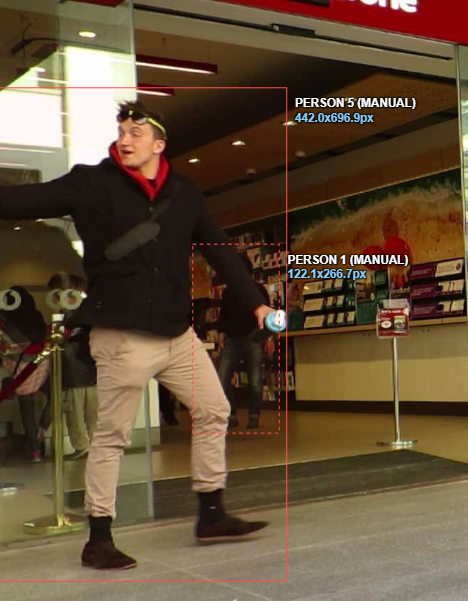
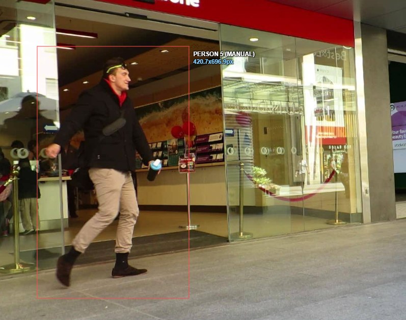
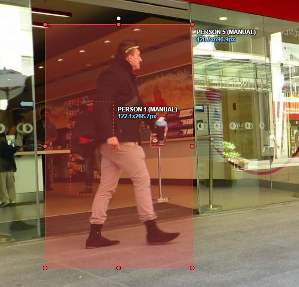

# Báo cáo cá nhân — HoVaTen-MSSV

Đổi tên file theo quy tắc `MSSV_HoTen.md`. Ví dụ: `20241234_NguyenVanAn.md`.

Đoạn video: MOT17-09, 150 frame (frame 1–150), nguồn MOTChallenge, giấy phép CC BY-NC-SA 3.0.

## 0. Thông tin học viên

- Họ tên: Nguyễn Trường Giang
- MSSV: 2A202603073
- Mã đề (A/B/C): C
- Email: truonggiangbg00@gmail.com
- Link repository: https://github.com/truonggiangbg00-ctrl/K5-L2-DAY05-NguyenTruongGiang-2A202603073-MOTTracking.git
- Giờ bắt đầu: 16h30
- Giờ kết thúc: 18h08

## 1. Xem trước đoạn video (CP0)

Ghi **trước khi vẽ**, mỗi người một dòng.

| Mã | Frame xuất hiện | Frame cuối thấy được | Rẽ / dừng / đổi tốc độ ở frame | Bị che ở frame | Ghi chú |
|---|---|---|---|---|---|
| P1 | 0 | 149 | 60–69, 80–110 Tăng tốc khoảng 60–69, sau đó chậm dần và gần như đứng yên từ khoảng 110 | 13 | Có mặt 144 frame; outside ở 43–48  |
| P2 | 1 | 149 | 24–100, 101–139 Box đứng yên từ khoảng 24–100, sau đó bắt đầu dịch chuyển chậm | 13 | Có mặt 128 frame; outside ở  107–127 |
| P3 | 27 | 149 | 39–60, 90–110, 140–149 Di chuyển nhanh hơn ở 39–60, sau đó nhìn chung giảm tốc | 7 | Có mặt 107 frame; outside ở  120–123, 137–148 |
| P4 | 39 | 149 | 80–130, 140–149 Tăng tốc rõ rệt từ khoảng 80–130, sau đó chậm lại | 29 | Có mặt 111 frame; không có outside |
| P5 | 60 | 149 | 80–120 Giảm tốc dần, gần như đứng yên từ khoảng 120 | 19 | Có mặt 91 frame; không có outside |

## 2. Keyframe và thời gian (CP1, CP4)

Số keyframe lấy từ kết quả `src/check_submission.py`.

| Mã | Số keyframe | Keyframe ở frame | Số frame có mặt | Keyframe / 100 frame | Thời gian (phút) | Chỗ khó |
|---|---|---|---|---|---|---|
| P1 | 19 | 0, 13, 23, 33, 49, 52, 54, 60, 65, 66, 67, 68, 69, 81, 92, 102, 113, 130, 149 | 144 | 13.2 | 2.4 | Đoạn `outside` 41–48, mở lại track tại 49; keyframe dày 65–69 |
| P2 | 6 | 1, 12, 23, 100, 128, 132 | 128 | 4.7 | 1.52 | Đoạn `outside` 107–127, cần rà soát đoạn nội suy 23–100 |
| P3 | 22 | 27, 28, 32, 37, 42, 49, 53, 62, 66, 76, 85, 86, 91, 94, 95, 103, 110, 115, 124, 131, 136, 149 | 107 | 20.6 | 1.85 | Hai đoạn `outside` 120–123 và 137–148; nhiều chỉnh sửa keyframe |
| P4 | 22 | 39, 46, 57, 63, 68, 77, 84, 95, 98, 103, 107, 113, 117, 121, 125, 128, 131, 133, 136, 140, 145, 149 | 111 | 19.8 | 2.1 | Nhiều keyframe ở nửa cuối đoạn; cần kiểm thay đổi chuyển động/kích thước |
| P5 | 10 | 59, 60, 68, 72, 82, 95, 112, 117, 148, 149 | 91 | 11.0 | 1.78 | 13 frame `occluded`; cần theo dõi khi mới xuất hiện |
| Tổng | 79 | — | 579 | 13.6 |  | 5 track, 3 track có khoảng `outside` |

Keyframe / 100 frame của cả bài = tổng keyframe ÷ tổng số frame có mặt × 100 = 77 ÷ 579 × 100 = 13.39879 ≈ 13.4

Bạn đặt keyframe nhiều nhất ở người nào? Vì sao (người đó rẽ, dừng, lại gần camera hay bị che)?

Hai track P3 và P4 cùng có nhiều keyframe nhất (22 keyframe). Tính theo 100 frame có mặt, P4 có mật độ cao nhất (19.8). Các keyframe của P4 tập trung nhiều ở đoạn 117–149. Lý do cụ thể là đổi hướng, đổi tốc độ, thay đổi kích thước hay che khuất, dựa trên video.

## 3. Đoạn bị che (CP2)

Người bị che: `P1`

| Mốc | Frame |
|---|---:|
| Bắt đầu bị che một phần (bật `occluded`) | 34 |
| Mất hẳn (bật `outside`) | 42 |
| Hiện lại (tắt `outside`) | 50 |
| Thấy rõ trở lại (tắt `occluded`) | 55 |

- Thời gian khuất hẳn: 8 frame = 8 giây.
- Quyết định: giữ cùng ID
- Lý do (trả lời 3 câu: khuất bao lâu so với 60 frame, ngoại hình có khớp, chỗ hiện lại có đúng hướng và tốc độ):

Khuất 8 frame so với 60 frame, ngoại hình khớp, chỗ hiện tại đúng hướng và đúng tốc độ

Ảnh chụp màn hình:





## 4. Tự review ID (CP3)

Lượt 1 theo người (đi ngược từ frame 149 về 0 trên CVAT), lượt 2 theo cảnh (nhảy 10 frame). Ít nhất 3 dòng; không có lỗi thì ghi một dòng "đã kiểm hai lượt, không lỗi".

Loại lỗi dùng đúng một trong 7 mã: `id_switch`, `fragmentation`, `lost`, `merge`, `false_track`, `drift`, `flag`.

| Frame | Mã người | Loại lỗi | Mô tả một câu | Phát hiện ở lượt | Đã sửa? |
|---:|---|---|---|---|---|
| | P1–P5 | Không có | Đã kiểm hai lượt, không phát hiện lỗi. | 1 và 2 | Không cần sửa |
| | | | | | |
| | | | | | |

Tổng hợp số lỗi theo loại:

| `id_switch` | `fragmentation` | `lost` | `merge` | `false_track` | `drift` | `flag` |
|---:|---:|---:|---:|---:|---:|---:|
| 0 | 0 | 0 | 0 | 0 | 0 | 0 |

Lỗi nào chỉ lượt 2 (theo cảnh) mới thấy, lượt 1 (theo người) không thấy? Vì sao?

Không có lỗi nào chỉ xuất hiện ở lượt 2. Khi rà soát theo cảnh, không phát hiện thêm lỗi ngoài kết quả lượt 1. Lượt 2 vẫn cần thiết vì giúp đối chiếu các track trên cùng một frame, đặc biệt ở chỗ các đối tượng đi sát hoặc che khuất nhau, nơi có nguy cơ id_switch, merge hay false_track

## 5. File xuất và kết quả tự kiểm (CP4)

| Kiểm tra | Kết quả |
|---|---|
| Tên file MOT 1.1 | `NguyenTruongGiang_mot.zip` |
| Tên file CVAT for video 1.1 | `NguyenTruongGiang_cvat_video.zip` |
| Số track ID khác nhau trong `gt/gt.txt` (phải là 5) | **5 — [OK]** |
| Frame `outside` không có dòng trong `gt.txt` (đúng / sai) | Đúng theo kết quả đối chiếu : P1 thiếu 43–48, track 2 thiếu 107–127, track 3 thiếu 120–123 và 137–148 |
| Job đã completed trên CVAT máy cá nhân | Đã completed |

Dán phần tóm tắt in ra từ `src/check_submission.py`:

```Số frame in theo CVAT (bắt đầu từ 0). Trong gt.txt, frame_id = frame CVAT + 1.

=== File MOT 1.1: NguyenTruongGiang_mot.zip ===
  Số track ID: 5   |   Tổng số box: 579
  [OK]        Đúng 5 track ID.

  Track | Frame có mặt | Số frame | Đoạn vắng (outside)
      1 |   0–149      |      142 | 41–48
      2 |   1–149      |      128 | 107–127
      3 |  27–149      |      107 | 120–123, 137–148
      4 |  39–149      |      111 | -
      5 |  59–149      |       91 | -


=== File CVAT for video 1.1: NguyenTruongGiang_cvat_video.zip ===

  Track | Nhãn   | Frame thấy | Keyframe | KF/100 frame | Frame occluded | Lần bật outside
      0 | person |        142 |       19 |         13.4 |             13 |               1
              Track 0: keyframe ở frame [0, 13, 23, 33, 49, 52, 54, 60, 65, 66, 67, 68, 69, 81, 92, 102, 113, 130, 149]
      1 | person |         91 |       10 |         11.0 |             13 |               0
              Track 1: keyframe ở frame [59, 60, 68, 72, 82, 95, 112, 117, 148, 149]
      2 | person |        111 |       22 |         19.8 |              7 |               0
              Track 2: keyframe ở frame [39, 46, 57, 63, 68, 77, 84, 95, 98, 103, 107, 113, 117, 121, 125, 128, 131, 133, 136, 140, 145, 149]
      3 | person |        128 |        6 |          4.7 |             29 |               1
              Track 3: keyframe ở frame [1, 12, 23, 100, 128, 132]
      4 | person |        107 |       22 |         20.6 |             19 |               2
              Track 4: keyframe ở frame [27, 28, 32, 37, 42, 49, 53, 62, 66, 76, 85, 86, 91, 94, 95, 103, 110, 115, 124, 131, 136, 149]

  Tổng: 79 keyframe / 579 frame có mặt = 13.6 keyframe / 100 frame
  [OK]        Đọc được 5 track từ annotations.xml.

=== Tóm tắt ===
  Lỗi: 0   |   Cảnh báo: 0
  Đạt. Dán phần tóm tắt này vào báo cáo mục 5.
...
```

## 6. Ba câu kết

1. Nếu được gán lại, bạn sẽ đặt keyframe khác ở đâu? Vì sao?

   Ưu tiên kiểm tra các đoạn ngay trước và sau outside của track 0 (43–49), track 3 (107–128) và track 4 (120–124, 137–149). Nếu box nội suy trôi khỏi toàn thân hoặc tốc độ/kích thước thay đổi rõ, cần thêm keyframe tại điểm thay đổi để hạn chế lỗi drift; không nên thêm keyframe chỉ để tăng số lượng.

2. Có chỗ nào bạn không chắc "cùng ID hay ID mới"? Bạn đã quyết định và ghi chú thế nào?

   Log cho thấy ba track được nối lại sau các đoạn outside ngắn hơn 60 frame và giữ ID cũ. Đây phù hợp về thời lượng với quy ước lớp; cần xem lại ngoại hình và hướng di chuyển để xác nhận đó đúng là cùng người, tránh nhầm người khi bị che.

3. Một lỗi ID trong job của bạn (nếu không còn sót, chọn lỗi đã sửa) có thể làm xe tự lái dự đoán sai chuyển động của người đó như thế nào? Lỗi đó ảnh hưởng MOTA hay IDF1 nhiều hơn?

   Không bị lỗi ID

## Bonus (nếu làm)

### B1 — Hai người đi sát

...

### B2 — So cách đặt keyframe

| Cách đặt | Số keyframe | Frame trôi nhất | Ghi chú |
|---|---:|---:|---|
| Đều mỗi 30 frame | | | |
| Theo chỗ đổi hướng | | | |

...

### B3 — So với tracker có sẵn

| Frame | Mã người | Tracker làm gì | Nhãn của bạn | Giải thích (đoán rồi sửa / ghép IoU / box score thấp / ngoại hình) |
|---:|---|---|---|---|
| | | | | |
| | | | | |

## 7. Tài liệu tham khảo và công cụ AI đã dùng

...
